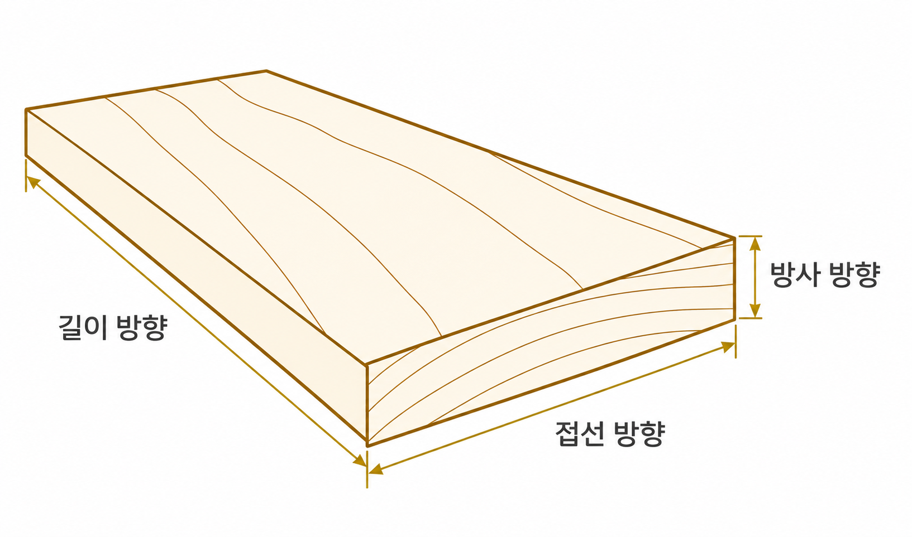

목재는 모든 방향으로 그리고 같은 비율로 수축 혹은 팽창하는 것이 아닙니다.
메이플, 체리 등의 하드우드에서는 나이테에 직각인 방향(방사방향, radial)에서의 치수변화량은 접선방향(tangential)의 절반 정도입니다.
이것은 상당한 양입니다.
다음에서 설명하듯이 무늬결제재(flatsawn) 판재에서는 너비굽음이 발생할 수 있습니다.

> 방향별로 일정하지 않은 치수변화
>
> 목재는 습도가 증가하면 팽창하고 습도가 감소하면 수축하는데, 모든 방향이 같은 비율로 길이가 변하는 것은 아닙니다.
> 접선방향(대략 나이테에 평행한 방향)의 변화량은 방사방향(나이테에 수직인 방향)의 변화량보다 큽니다.
> 길이방향(나뭇결 방향)의 변화량은 무시할 만합니다.