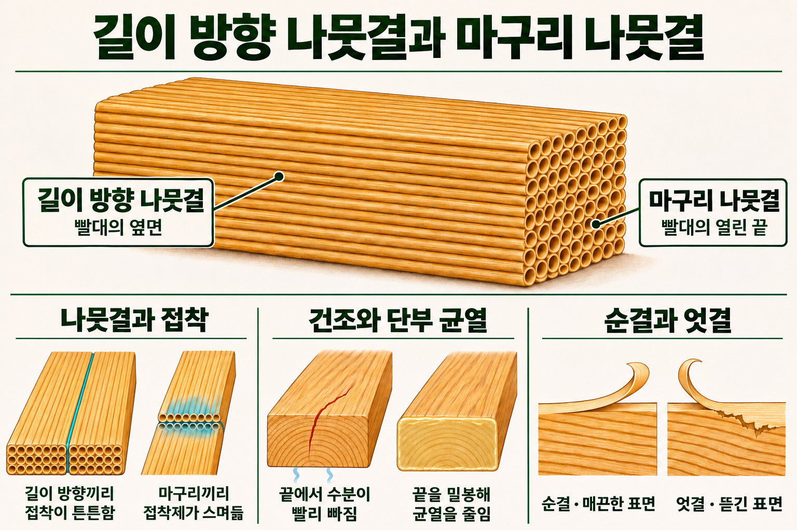
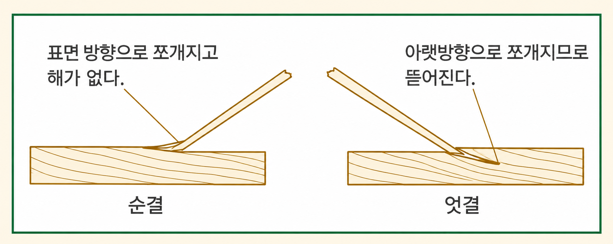

길이방향 나뭇결(long grain)과 마구리 나뭇결(end grain)을 쉽게 이해하기 위해서 먼저 판재를 접착제로 많은 빨대를 한꺼번에 붙여둔 모양으로 가정합니다.

외부에서 보이는 네 면을 길이방향 나뭇결이라고 합니다.
판재의 양쪽 끝은 빨대의 열린 끝 부분이고 이 부분을 마구리 나뭇결이라고 합니다.

목재를 서로 접착시킬 때는 나뭇결이 길이방향이냐 아니면 마구리냐가 중요합니다.

두 판재의 가장자리를 서로 접착시키는 것은 나무 내부의 빨대를 섬유소(실제로는 세포 사이를 붙여 주는 리그닌·펙틴) 대신에 인공 접착제로 붙이는 것이라고 생각할 수 있습니다.

요즘 시판되는 목공용 접착제는 섬유소보다 더 강하기 때문에 길이방향으로 나뭇결을 서로 접착시키는 것은 매우 튼튼하나 마구리 나뭇결을 이용해서 접착시키는 것은 튼튼하지 못합니다.

마구리에는 세포의 공극이 많고 이를 통해서 접촉면에서 접착제를 빨아들여 버리기 때문에 접착이 잘되지 않습니다.

> WOOD TIP
>
> 마구리 나뭇결은 열린 상태이기 때문에 길이방향 나뭇결보다 수분 이동이 훨씬 빠르게 일어나는 부분입니다.
> 마르는 판재의 양쪽 끝부분을 밀봉하지 않으면 다른 부분보다 빨리 수축합니다.
> 목재를 일정기간 보관하려면 왁스, 페인트, 마감재 등으로 양쪽 끝부분을 일단 밀봉해서 균열이 생기는 것을 막아야 합니다.

> 순결로 깎기
>
> ’엇결’이라는 말을 들어보았을 것입니다.
> 목재를 구성하는 긴 세포를 가로질러 자르는 것보다는 세포를 길이방향으로 쪼개는 것이 더 쉽습니다.
> 도끼로 통나무를 잘라보면 균열이 섬유조직을 가로질러 잘리면서 생기는 것이 아니고, 섬유조직을 따라가면서 쪼개진다는 것을 알 수 있습니다.
> 손대패, 끌, 자동 대패의 날을 도끼로 간주할 수 있습니다.
> 목재 내부로 파고 들어가면 쐐기작용으로 인해서 결방향으로 쪼개집니다.
> 순결로 깎는다면 표면방향으로 쪼개지고 나쁜 영향이 없습니다.
> 그러나 엇결로 깎는다면 중심방향으로 쪼개지므로 목재가 뜯기게 됩니다.