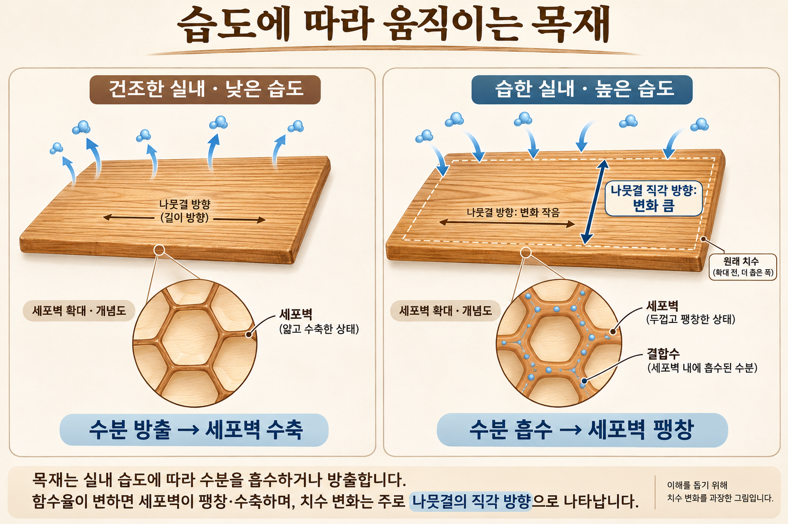

오늘은 '물과 나무'에 대하여 공부했습니다.

나무의 세포막(오늘날의 세포벽)은 스펀지 같은 재료로 구성되어 있다고 합니다.
때문에 수분을 매우 잘 흡수한다고 합니다.

식탁 상판과 같은 건조한 목재도 계절과 날씨에 따라 실내 습도가 변하면서 수분을 빨아들이기도 하고
내뿜기도 한다고 합니다.

함수량에 따라 세포막은 수축 혹은 팽창합니다.

> **“함수량(含水量)”이란 무엇일까요?**
>
> 함수량(含水量)은 어떤 물질에 들어 있는 물의 양을 말합니다.
> 목재, 흙, 곡물, 식품, 콘크리트 골재 등 여러 분야에서 쓰입니다.
> 보통은 전체 중 물이 차지하는 비율인 함수율(%)로 나타냅니다.

> **그렇다면 "목재의 함수율은 무엇일까요?"**
>
> 목재에서 이 값이 특히 중요합니다.
> 목재는 물기를 완전히 뺀 무게(전건 중량)를 기준으로 계산합니다.
>
> - 함수율(%) = (젖은 상태의 무게 - 전건 무게) / 전건 무게 x 100
>
> 분모가 전체 무게가 아니라 마른 나무 무게라서, 갓 벤 생재는 함수율이 100%를 넘는 경우도 있습니다.
> 나무 무게보다 물 무게가 더 무거운 셈입니다.

> **“기건 함수율”이란 무엇일까요?**
>
> 목재를 실내외 공기 중에 오래 두면 주변 습도와 균형을 이루는 함수율에 머무는데, 이를 기건 함수율이라고 합니다.
> 우리나라 환경에서는 대략 12~15% 수준입니다.
> 그래서 가구나 실내 마감재는 사용할 환경에 맞춰 이 정도나 그보다 조금 낮게 건조한 목재를 사용합니다.

따라서 습도가 증가하면 식탁 상판이 나뭇결과 직각방향으로 늘어나는 반면, 결방향으로는 치수가 별로 변하지 않는다고 합니다.

이처럼 목재는 치수가 일정하지 않고 방향별로 치수가 각각 달라지기 때문에, 특별한 방법으로 부재(部材)를 영구적으로 결합시킨다고 합니다.

> **부재(部材)**
>
> 건물이나 가구 같은 구조물을 이루는 하나하나의 재료(부품)를 말합니다.
> 목조 건축이라면 기둥, 보, 도리, 서까래, 창방 같은 개별 나무 토막 하나하나가 각각 부재입니다.
> 영어로는 member라고 합니다.

이 방법을 통칭해서 결합(joinery)이라 한다고 합니다.

결합(joinery)은 다음에 알아보도록 하겠습니다.
