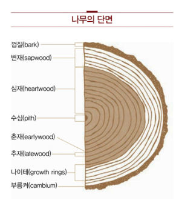

목재는 나무에서 얻는 천연재료이기 때문에 일정하지 않고 각기 다르다.

바람, 양지, 음지, 토양, 입지, 강우, 나무 사이의 경쟁 등으로 인해서 각 나무는 색상, 밀도, 나뭇결의 형상, 생산 목재의 기능적 특징 등이 다르다.

목재를 이용해서 가구를 만들면 각 판재는 사용 공구를 통해서 각기 독특하게 표현된다.

나무의 생물학적 측면과 자라는 과정에서 생기는 변수를 이해하려는 노력이 목공의 출발점이다.

---

## 물리적인 성질

목재는 줄기, 굵은 가지, 잔 가지 등에 들어 있는 기다란 세포로 구성되어 있다.

이 세포는 기본적으로 섬유소(cellulose)로 구성되어 있는데 목질소(lignin)라 불리는 접착제에 의해서 서로 붙어 있다.
> 빨대 다발(세포)을 접착제(목질소)로 붙여둔 모양으로 생각하면 된다.

섬유질 빨대를 길이 방향과 직각되게 자르는 것은 어렵지만 하나씩 뜯어내는 것은 상대적으로 쉽다.
따라서 목재는 나뭇결을 가로지르는 방향보다 나뭇결 방향으로 더 잘 갈라진다.

나무의 단면은 여러 성장 단계를 보여준다.

둘레가 껍질(수피)이다.
외수피는 곤충, 동물, 외기, 마모 등으로부터 나무를 보호한다.
잎에서 광합성을 통해 생성된 영양분은 내수피를 통해서 얇은 성장 세포층인 부름켜(cambium)로 이동한다.

모든 성장은 부름켜에서 일어난다.
바깥쪽 세포는 껍질이 되고 안쪽 세포는 새로운 나무가 된다.

> 디자인에서의 색상
>
> 월넛(Walnut, 호두나무)을 어둡고 진한색의 목재라고 생각한다면 심재를 말하는 것이다.
> 월넛의 변재는 대부분의 다른 하드우드와 마찬가지로 약간 연하고 무르다.
> 월넛, 체리(cherry, 벚나무), 오크(oak, 참나무)는 심재가 가치가 있다.
> 메이플(maple, 단풍나무), 애쉬(ash, 물푸레나무) 등에서는 미색의 변재를 선호한다.
> 가구를 만들 때는 변재와 심재를 섞어서 대비시키든지, 아니면 같은 색조를 유지하든지 선택해서 작업 할 수 있다.

매년 부름켜는 변재의 바깥쪽 테를 생성하는데, 뿌리에서 흡수된 물이 여기를 통해서 나무 꼭대기로 이동한다.
변재의 가장 안쪽 테는 수액을 위로 올릴 수 있는 능력을 잃고 딱딱해지면서, 나무의 골격이라고 할 수 있는 심재가 된다.
나무의 중심 부분이 수심이다.

나무는 대부분 여름보다는 봄에 많이 자란다.
이로 인해서 하나의 나이테 안에서도 밀도와 색상이 다르다.
나이테의 안쪽 부분은 봄에 많이 자라면서 형성되는 부분으로 춘재(earlywood)라고 하는데, 세포의 지름이 크고 색상도 여름에 자라는 추재(latewood)와는 다르다.
