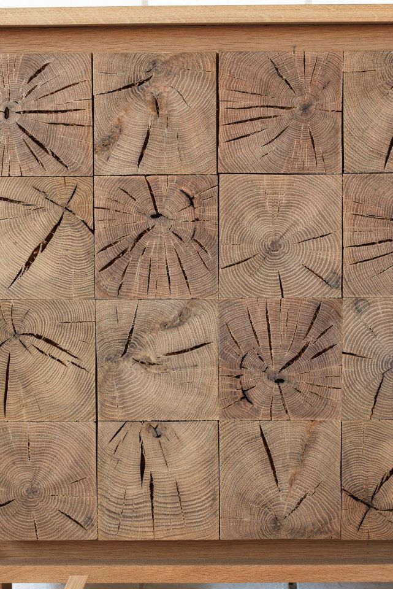

제재목(製材木)으로 사용되는 교목(喬木)에는 두 종류의 물이 포함되어 있습니다.

> **’제재목(製材木)’이란?**
>
> 원목(통나무)을 톱으로 켜서 일정한 치수와 모양으로 잘라 낸 목재입니다.
> 영어로는 sawn timber 또는 lumber라고 하며, 원목을 켜는 작업 자체는 ‘제재(製材)’라고 부릅니다.
> 널빤지 형태의 판재와 기둥 형태의 각재로 나뉘며, 얇은 판이나 조각을 접착해 만든 합판 • 집성재 같은 가공 목재와는 구분됩니다.

> **’교목(喬木)’이란?**
>
> 하나의 굵은 원줄기가 곧게 뻗어 높이 자라는 나무를 말합니다.
> 소나무, 참나무, 은행나무 등이 있으며, 영어로는 tree라고 합니다.
> 밑동에서 여러 줄기가 갈라져 낮게 자라는 관목(灌木, shrub)과 구분됩니다.

세포 사이를 흘러 다니는 자유수(free water)와 세포의 섬유소막(오늘날의 세포벽) 내에 흡수된 결합수(bound water)입니다.

> 목재 속 물은 어디에 들어 있느냐에 따라 자유수와 결합수로 나뉩니다.
> 목재는 속이 빈 가늘고 긴 세포들이 모인 구조라서, 물이 들어갈 수 있는 자리가 세포 안의 빈 공간과 세포벽 자체 두 곳이기 때문입니다.
- 자유수(自由水, free water)
  - 세포 안의 빈 공간(세포 내강)이나 세포 사이 틈에 액체 상태로 고여 있는 물입니다.
    - 빨대 속에 물이 차 있는 모습을 떠올리면 됩니다.
  - 세포벽에 붙잡혀 있지 않아서 비교적 쉽게 움직이고, 건조할 때 먼저 빠져나갑니다.
  - 자유수는 빠져도 세포벽 자체는 그대로라서 목재의 크기나 강도는 거의 변하지 않고 무게만 줄어듭니다.
- 결합수(結合水, bound water)
  - 세포벽을 이루는 셀룰로오스와 헤미셀룰로오스 분자 사이에 수소 결합으로 붙잡혀 있는 물입니다.
  - 세포벽 사이사이에 스며들어 벽을 부풀려 놓은 상태라서, 이 물이 빠지면 셀룰로오스 사이 간격이 좁아지면서 목재가 수축합니다.
  - 반대로 습도가 높아져 다시 흡수하면 팽창합니다.
  - 분자에 붙잡혀 있어 자유수보다 빼내는 데 더 많은 에너지가 듭니다.
- 자유수와 결합수를 가르는 기준: 섬유포화점
  - 생재를 말리면 자유수가 먼저 다 빠지고, 세포벽은 결합수로 아직 꽉 찬 상태가 되는 지점이 옵니다.
    - 이것을 섬유포화점이라고 하며 함수율로 대략 25~30%입니다.
      - 섬유포화점 위: 자유수만 줄어듦 → 치수 변화 거의 없음
      - 섬유포화점 아래: 결합수가 줄어듦 → 수축이 시작되고, 대신 목재가 점점 단단하고 강해짐
        - 그래서 “습도에 따라 식탁 상판이 늘고 줄어드는 현상”은 바로 결합수가 드나들면서 생기는 일입니다.
        - 기건 함수율(12~15%)은 섬유포화점보다 한참 아래이기 때문에, 이미 건조된 목재는 공기 중 습도 변화에 따라 결합수를 주고받으며 계속 조금씩 움직입니다.

생나무의 경우 자유수와 결합수를 합한 무게는 나무 자체보다 더 무겁다고 합니다.
가구를 만들기 위해서 인공 건조시킨 제재목에는 자유수는 없고 결합수가 무게 기준으로 6~8% 정도 포함되어 있다고 합니다.

원목에서 모든 자유수 및 대부분의 결합수가 제거되도록, 마를 때까지 그냥 놔둬서는 안 된다고 합니다.
나무는 건조하면 수축하고, 제어되지 않은 수축이 발생하면 나무에 균열이 생기고 갈라지기 때문입니다.

원목을 잘라서 바닥에 두면, 수분은 껍질 및 새로 절단된 단면을 통해서 기화한다고 합니다.
나무를 감싸는 둘레부분이 건조하면 지름이 줄어들지만, 아직 내부의 함수량에는 큰 변화가 없기 때문에 크기가 일정합니다.
따라서 외부 둘레 섬유조직에서 인장력이 발생하면서 표면이 갈라지고 내부로 균열이 진전되는 것입니다.

원목의 단부에서도 수분이 기화하면서 수축하려고 하지만, 습기가 많은 내부에 연결되어 있기 때문에 수축하기 어렵습니다.
따라서 원목의 단부(端部)가 갈라지면서 인장력이 줄어드는 현상이 발생합니다.

> **원목의 단부(端部)**
>
> 통나무의 양쪽 끝, 즉 잘린 끝면과 그 주변을 말하며 목공에서는 마구리라고도 부릅니다.
> 뿌리 쪽 굵은 끝을 원구(元口), 꼭대기 쪽 가는 끝을 말구(末口)라고 합니다.
> 단부는 수분이 빠르게 빠져나가 갈라지기 쉬워서, 왁스나 전용 도료를 발라 보호합니다.

원목을 벌목해서 그냥 건조되도록 내버려두면 균열이 발생하여 목재로서의 가치가 떨어집니다.
해법은 원목을 판재(板材)로 제재한 후에 판재의 단부에 왁스나 페인트를 칠해서 봉합하는 것입니다.

> **판재(板材)**
>
> 두께에 비해 폭이 넓은 널빤지 형태의 제재목(製材木)입니다.
> 영어로는 board 또는 plank라고 합니다.
> 바닥재, 벽 마감재, 가구 상판, 선반 등에 쓰입니다.
> 정확한 구분 기준은 규격마다 다르지만, 대체로 두께가 얇고(약 75mm 미만) 폭이 두께의 몇 배 이상 넓은 것을 판재, 단면이 정사각형에 가까운 굵은 것을 각재로 봅니다.

판재 사이에 잔목(간격재)을 끼워 공기가 통하도록 수평으로 쌓고, 햇빛이 들지 않으면서 너무 건조하지 않은 곳에 보관해야 합니다.
이것을 천연건조(air-drying)라고 하는데, 판재 두께 25mm당 1년 정도의 시간이 필요합니다.

> **잔목(棧木)**
>
> 판재(板材) 같은 제재목을 여러 층으로 쌓아 말릴 때, 층과 층 사이에 가로로 끼워 넣는 가는 막대입니다.
> 영어로는 sticker라고 합니다.
> 일본어 桟木(산기)에서 온 말이라 요즘은 ‘간격재’라는 우리말 용어를 더 많이 씁니다.
> 이렇게 잔목을 끼워 가며 쌓는 방식을 잔적(棧積)이라고 합니다.

> **간격재(間隔材)**
>
> 이름 그대로 부재와 부재 사이에 간격을 띄우기 위해 끼우는 재료입니다.
> 목재 건조 맥락에서는 잔목과 같은 것을 가리킵니다.
> 참고로 건축 전반에서는 철근과 거푸집 사이를 띄우는 spacer처럼 다른 용도로도 쓰입니다.

제재소는 천연건조 방식을 사용할 수 있을 정도로 오래 재고를 둘 수 없기 때문에, 건조기인 킬른(kiln)을 사용해서 수분을 제거합니다.
킬른 내부에 판재를 위로 쌓는데, 간격재로 판재 사이를 띄웁니다.
킬른 내부로 따뜻하고 습한 공기를 순환시킵니다.
순환 공기의 습도를 판재의 습도보다 약간 더 낮은 상태로 유지하면서 습도를 순차적으로 줄여 나갑니다.
이런 제어 방식을 인공건조(kiln-drying)라고 하며, 제대로 하면 균열이 발생하지 않습니다.

